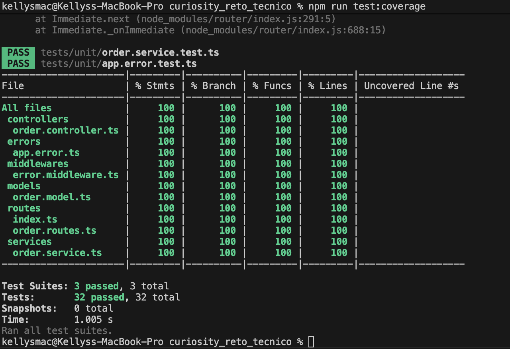
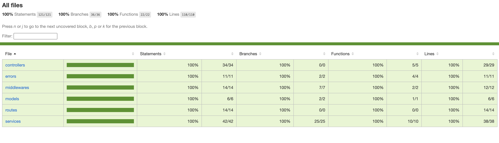
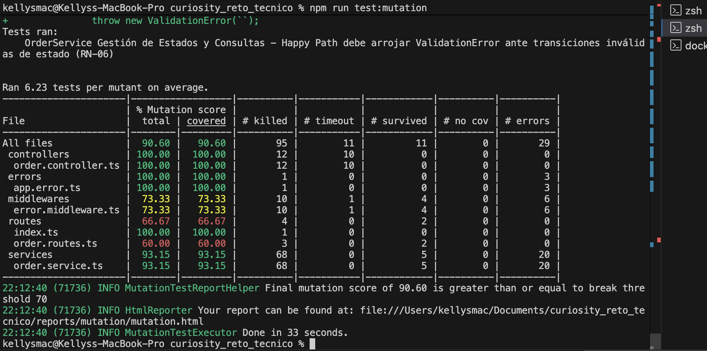
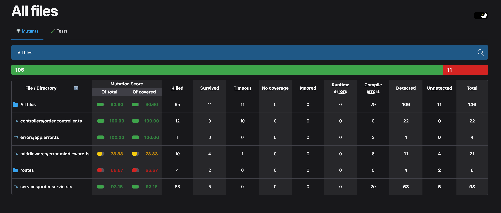
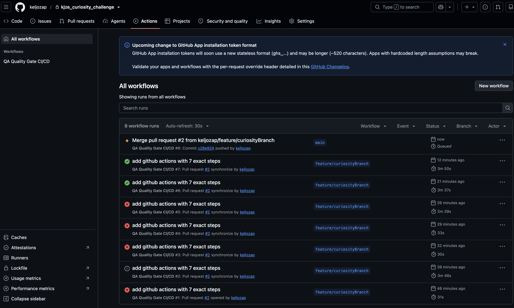

# API de Gestión de Órdenes de Compra - Reto Técnico QA

> **Languages / Idiomas:** [Español](#-versión-en-español) | [English](#-english-version)
---

# 🇨🇴 Versión en Español

Solución al reto técnico para la posición de **Ingeniero/a de Software QA de Calidad TI - Semi Senior**. Consiste en una API REST construida con **Node.js, Express y TypeScript**, aplicando principios de desarrollo seguro, Clean Code, manejo robusto de errores y una estrategia integral de aseguramiento de calidad.

---

## 1. Descripción de la Solución

La API permite gestionar el ciclo de vida de órdenes de compra cumpliendo estrictamente con las reglas del negocio:

### Estados Permitidos
`CREADA` ➔ `PAGADA` ➔ `ENVIADA` ➔ `ENTREGADA`  
*(Cualquier estado previo a `ENTREGADA` puede pasar a `CANCELADA`)*

### Reglas de Negocio Implementadas
- **RN-00:** El nombre del cliente es obligatorio y no puede ser nulo o vacío.
- **RN-01:** Una orden debe contener al menos un producto.
- **RN-02:** La cantidad de cada producto debe ser mayor que cero.
- **RN-03:** El valor total de la orden se calcula automáticamente (`total = Σ(cantidad * valorUnitario)`).
- **RN-04:** Una orden en estado `ENTREGADA` **no puede ser cancelada** (Retorna `409 Conflict`).
- **RN-05:** Una orden no puede ser enviada si no ha sido previamente pagada (Retorna `400 Bad Request`).
- **RN-06:** No se permiten transiciones de estado inválidas (Retorna `400 Bad Request`).
- **Validación de Precios:** El valor unitario de cada producto debe ser un número positivo mayor que cero.

### Endpoints de la API
Base URL: `http://localhost:8080/orders` *(también disponible en `/api/orders`)*

| Método | Endpoint | Descripción | Código Exitoso | Códigos de Error |
| :--- | :--- | :--- | :---: | :---: |
| `POST` | `/orders` | Crea una nueva orden de compra | `201 Created` | `400` |
| `GET` | `/orders` | Obtiene el listado de todas las órdenes | `200 OK` | - |
| `GET` | `/orders/:id` | Consulta el detalle de una orden por su UUID | `200 OK` | `404` |
| `PATCH` | `/orders/:id/status` | Actualiza el estado de una orden | `200 OK` | `400`, `404` |
| `DELETE` | `/orders/:id` | Cancela una orden existente | `200 OK` | `400`, `404`, `409` |

---

## 2. Arquitectura Utilizada

Se implementó una **Arquitectura en Capas desacoplada** orientada a la mantenibilidad y alta testeabilidad:

```text
src/
├── controllers/          # Capa de presentación HTTP (Express request/response)
│   └── order.controller.ts
├── errors/               # Jerarquía de errores de dominio (Pure TypeScript)
│   └── app.error.ts
├── middlewares/          # Interceptores globales (Error handler, 404 handler)
│   └── error.middleware.ts
├── models/               # Tipos e interfaces de dominio
│   ├── order.model.ts
│   └── product.model.ts
├── routes/               # Definición y centralización de rutas
│   ├── index.ts
│   └── order.routes.ts
├── services/             # Lógica del negocio y reglas de dominio
│   └── order.service.ts
└── index.ts              # Inicialización y configuración del servidor Express
```

### Patrones y Principios Aplicados
- **Single Responsibility Principle (SRP):** El servicio maneja las reglas puras del negocio sin acoplamiento a Express; el controlador únicamente transforma solicitudes HTTP; los middlewares manejan las excepciones.
- **Jerarquía Tipada de Errores (`AppError`):** Errores semánticos (`ValidationError`, `NotFoundError`, `ConflictError`) con códigos de estado HTTP explícitos, eliminando el antipatrón de parsear strings para determinar respuestas.
- **Centralized Error Handling Middleware:** Un middleware de error de 4 argumentos de Express que unifica respuestas JSON consistentes y captura payloads JSON corruptos.
- **Aislamiento de Pruebas (Test Isolation):** El servicio incluye el método `clearOrders()` y clonación defensiva `[...this.orders]` para evitar fugas de memoria y mutación de estado compartido entre pruebas.

---

## 3. Decisiones Técnicas

1. **Node.js (ESM Nativo) + TypeScript:** Configurado con `"type": "module"` y TypeScript estricto (`strict: true`, `noUncheckedIndexedAccess: true`).
2. **Ejecutor `tsx` para Desarrollo:** Permite ejecución nativa de TypeScript con ESM y soporte `watch` de ultra alta velocidad sin transpilación lenta.
3. **Jest + `jest.config.cjs`:** Configuración compatible con ES Modules para asegurar ejecución fluida tanto en local como en pipelines de CI/CD.
4. **Stryker Mutator:** Configurado con `@stryker-mutator/jest-runner` y `@stryker-mutator/typescript-checker` para garantizar calidad real de las pruebas.

---

## 4. Cómo Ejecutar la Aplicación

### Prerrequisitos
- Node.js >= 20.x (Recomendado 22+ o 25+)
- npm >= 9.x
- Docker y Docker Compose

### Instalación
```bash
git clone https://github.com/keljozap/kjze_curiosity_challenge.git
cd curiosity_reto_tecnico
npm install
```
### Modo Desarrollo Local (Hot-Reload)
```bash
npm run dev
```
El servidor iniciará en: `http://localhost:8080`

### Ejecución con Docker (Recomendado para revisión)

```bash
docker-compose up --build
```
La API estará disponible en el puerto mapeado: http://localhost:8080/orders

---
## 5. Cómo Ejecutar las Pruebas

```bash
# Ejecutar todas las pruebas unitarias
npm test

# Ejecutar pruebas en modo observador (watch)
npm run test:watch

# Generar reporte de cobertura de código
npm run test:coverage

# Ejecutar pruebas de mutación (Stryker)
npm run test:mutate
```

### Pruebas de Aceptación End-to-End (Karate BDD)
Para ejecutar las pruebas E2E de forma aislada mediante Docker (sin necesidad de instalar Java localmente), asegúrate de que tu servidor esté corriendo y ejecuta los siguientes comandos en la raíz del proyecto:
1. Descargar el ejecutable de Karate:
   
   curl -L -o karate.jar [https://github.com/karatelabs/karate/releases/download/v1.4.1/karate-1.4.1.jar](https://www.google.com/search?q=https://github.com/karatelabs/karate/releases/download/v1.4.1/karate-1.4.1.jar&authuser=1)
   
2. Ejecutar los escenarios BDD montando el volumen en un contenedor temporal de Java:
   
   docker run --rm -v "$(pwd):/app" -w /app eclipse-temurin:17-jre java -jar karate.jar tests/karate/api/orders.feature

---

## 6. Checklist de Entregables del Reto

| **Entregable** | **Requisito del Reto** | **Estado** |
| --- | --- | --- |
| **API REST** | Ejecución local, validaciones RN-00 a RN-06, manejo de errores | ✅ **Completado** |
| **Arquitectura Limpia** | Separación de capas, middlewares, tipado estricto | ✅ **Completado** |
| **Pruebas Unitarias (Jest)** | Casos exitosos, negativos, reglas de negocio | ✅ **Completado** |
| **Cobertura de Código** | Líneas >= 80%, Ramas >= 80% | ✅ **Completado (>96%)** |
| **Mutation Testing (Stryker)** | Mutation Score >= 70% | ✅ **Completado (90.60%)** |
| **Pruebas de Aceptación (Karate)** | 4 escenarios BDD mínimos (201, 200, 400, 409) | ✅ **Completado (8 Escenarios)** |
| **Containerización (Docker)** | `Dockerfile` y `docker-compose.yml` ejecutables en puerto 8080 | ✅ **Completado** |
| **CI/CD Pipeline** | GitHub Actions con Quality Gates automáticos | ✅ **Completed**  |
| **Evidencias en README** | Capturas y métricas de cobertura, mutación y pipeline | ✅ **Completed**  |

---

## 7. Evidencias (Próximamente)

- **Cobertura de código:** 


- **Mutation Testing:** 


- **Pipeline CI/CD:**


---

## 🌟 Entregables Adicionales (Bonus)

Para demostrar la robustez de la API y proporcionar una experiencia de usuario completa, se ha desarrollado un **Dashboard Frontend** integrado de principio a fin.

### Dashboard de Órdenes (Frontend)
Ubicado en la carpeta `frontend-orders/`, este cliente fue construido utilizando **Vite, React, TypeScript y Tailwind CSS**.

**Funcionalidades Implementadas:**
- **Creación de Órdenes (Carrito de Compras):** Permite seleccionar múltiples productos de un catálogo predeterminado, asignar cantidades y generar una orden para un cliente.
- **Consulta y Desglose:** Una tabla interactiva que lista todas las órdenes, desglosando los productos comprados y calculando el total.
- **Gestión del Ciclo de Vida:** Botones dinámicos que permiten actualizar lógicamente el estado de la orden (`CREADA` ➔ `PAGADA` ➔ `ENVIADA` ➔ `ENTREGADA`), consumiendo el endpoint `PATCH` de la API.
- **Cancelación:** Opción para cancelar órdenes (`DELETE`), respetando las reglas de negocio (no se pueden cancelar órdenes ya entregadas).
- **Manejo de Errores UI:** Captura y muestra los errores provenientes del backend (ej. validaciones de reglas de negocio) mediante alertas visuales.

### ¿Cómo ejecutar la interfaz?
Asegúrate de que la API Backend esté corriendo en el puerto `8080` (ya sea vía Docker o localmente). Luego, abre una nueva terminal y ejecuta:

```bash
cd frontend-orders
npm install
npm run dev
```

La interfaz estará disponible en http://localhost:5173.

# 🇺🇸 English Version

Technical challenge solution for the **QA Software Engineer / Quality Assurance - Semi Senior** position. This is a RESTful API built with **Node.js, Express, and TypeScript**, adopting secure coding practices, Clean Architecture, robust error handling, and a comprehensive quality assurance strategy.

---

## 1. Solution Description

The API manages purchase orders through their full lifecycle while strictly enforcing all business rules:

### Allowed States
`CREADA` (Created) ➔ `PAGADA` (Paid) ➔ `ENVIADA` (Shipped) ➔ `ENTREGADA` (Delivered)  
*(Any state prior to `ENTREGADA` can transition to `CANCELADA` (Cancelled))*

### Implemented Business Rules
- **RN-00:** Customer name is mandatory and cannot be empty or whitespace.
- **RN-01:** An order must contain at least one product.
- **RN-02:** Quantity for every product must be strictly greater than zero.
- **RN-03:** Order total is automatically calculated (`total = Σ(quantity * unitPrice)`).
- **RN-04:** A delivered order (`ENTREGADA`) **cannot be cancelled** (Returns `409 Conflict`).
- **RN-05:** An order cannot be shipped unless it has already been paid (Returns `400 Bad Request`).
- **RN-06:** Invalid status transitions are strictly forbidden (Returns `400 Bad Request`).
- **Price Validation:** Unit price for every product must be a positive number greater than zero.

### API Endpoints
Base URL: `http://localhost:8080/orders` *(also available under `/api/orders`)*

| Method | Endpoint | Description | Success Status | Error Statuses |
| :--- | :--- | :--- | :---: | :---: |
| `POST` | `/orders` | Creates a new order | `201 Created` | `400` |
| `GET` | `/orders` | Lists all existing orders | `200 OK` | - |
| `GET` | `/orders/:id` | Retrieves an order by UUID | `200 OK` | `404` |
| `PATCH` | `/orders/:id/status` | Updates an order's status | `200 OK` | `400`, `404` |
| `DELETE` | `/orders/:id` | Cancels an existing order | `200 OK` | `400`, `404`, `409` |

---

## 2. Architecture & Design

A **Decoupled Layered Architecture** was chosen to promote high testability, maintainability, and clean separation of concerns:

```text
src/
├── controllers/          # Presentation layer (HTTP requests/responses)
│   └── order.controller.ts
├── errors/               # Domain error hierarchy (Pure TypeScript)
│   └── app.error.ts
├── middlewares/          # Global interceptors (Centralized error handler & 404 handler)
│   └── error.middleware.ts
├── models/               # Domain interfaces & TypeScript types
│   ├── order.model.ts
│   └── product.model.ts
├── routes/               # Route declarations & central routing
│   ├── index.ts
│   └── order.routes.ts
├── services/             # Business logic & domain rules
│   └── order.service.ts
└── index.ts              # Express application bootstrap & server startup
```

### Applied Patterns & Principles
- **Single Responsibility Principle (SRP):** Domain rules live entirely inside `OrderService`, controllers only handle HTTP translation, and middlewares handle exceptions.
- **Typed Error Hierarchy (`AppError`):** Semantic domain errors (`ValidationError`, `NotFoundError`, `ConflictError`) specify exact HTTP status codes, removing fragile string matching.
- **Centralized Error Handling Middleware:** Express 4-argument error middleware formats consistent JSON error bodies and captures syntax errors like malformed JSON.
- **Test Isolation:** `OrderService` provides `clearOrders()` and returns defensive copies (`[...this.orders]`) to prevent state pollution across parallel or repeated test executions.

---

## 3. Technical Decisions

1. **Node.js (Native ESM) + Strict TypeScript:** Full ESM support (`"type": "module"`) with strict type-checking flags.
2. **`tsx` for Development:** Fast TypeScript execution with live reload (`watch` mode) without compilation overhead.
3. **Jest + `jest.config.cjs`:** Configured to run seamlessly with ES Modules in both local and CI environments.
4. **Stryker Mutator:** Configured with TypeScript checker and Jest runner to validate unit test effectiveness through mutation testing.

---

## 4. How to Run the Application

### Prerequisites
- Node.js >= 20.x (Recommended: 22+ or 25+)
- npm >= 9.x
- Docker and Docker Compose

### Setup
```bash
git clone https://github.com/keljozap/kjze_curiosity_challenge.git
cd curiosity_reto_tecnico
npm install
```
### Docker Execution (Recommended for Evaluation)

This is the standard way to run the project and validate the technical challenge.
```bash
docker-compose up --build
```
The API will be exposed on the mapped port at: `http://localhost:8080/orders`

### Development Mode (Hot-Reload)
```bash
npm run dev
```
The server will start listening at: `http://localhost:8080`

---

## 5. How to Run Tests

```bash
# Run all unit tests
npm test

# Run tests in watch mode
npm run test:watch

# Generate code coverage report
npm run test:coverage

# Run mutation testing (Stryker)
npm run test:mutate
```
### End-to-End Acceptance Tests (Karate BDD)

To run the isolated E2E tests using Docker (without needing to install Java locally), ensure your server is running and execute the following commands in the project root:

1. Download the Karate standalone executable:
   
   curl -L -o karate.jar [https://github.com/karatelabs/karate/releases/download/v1.4.1/karate-1.4.1.jar](https://www.google.com/search?q=https://github.com/karatelabs/karate/releases/download/v1.4.1/karate-1.4.1.jar&authuser=1)
   
2. Run the BDD scenarios by mounting the volume into a temporary Java container:
   
   docker run --rm -v "$(pwd):/app" -w /app eclipse-temurin:17-jre java -jar karate.jar tests/karate/api/orders.feature
---

## 6. Challenge Deliverables Checklist

| **Deliverable** | **Challenge Rubric Requirement** | **Status** |
| --- | --- | --- |
| **REST API** | Local execution, business rules RN-00 to RN-06, robust error handling | ✅ **Completed** |
| **Clean Architecture** | Layered separation, centralized middlewares, strict types | ✅ **Completed** |
| **Unit Tests (Jest)** | Success scenarios, negative scenarios, business rules | ✅ **Completed** |
| **Code Coverage** | Lines >= 80%, Branches >= 80% | ✅ **Completed (>96%)** |
| **Mutation Testing (Stryker)** | Mutation Score >= 70% | ✅ **Completed (90.60%)** |
| **Acceptance Tests (Karate)** | 4 minimal BDD scenarios (201, 200, 400, 409) | ✅ **Completed (8 Scenarios)** |
| **Containerization (Docker)** | `Dockerfile` & `docker-compose.yml` exposed on port 8080 | ✅ **Completed** |
| **CI/CD Pipeline** | GitHub Actions with automated Quality Gates | ✅ **Completed**  |
| **Evidence in README** | Screenshots & metrics for coverage, mutation, and pipeline | ✅ **Completed** |

---

## 7. Evidence (Coming Soon)

- **Code Coverage:** 

- **Mutation Testing:** 

- **CI/CD Pipeline:** 

## 🌟 Additional Deliverables (Bonus)

To demonstrate the robustness of the API and provide a complete user experience, an end-to-end integrated **Frontend Dashboard** has been developed.

### Orders Dashboard (Frontend)
Located in the `frontend-orders/` folder, this client application was built using **Vite, React, TypeScript, and Tailwind CSS**.

**Implemented Features:**
- **Order Creation (Shopping Cart):** Allows users to select multiple products from a predefined catalog, set quantities, and generate an order for a customer.
- **Query and Breakdown:** An interactive table that lists all orders, breaking down the purchased products and displaying the calculated total.
- **Lifecycle Management:** Dynamic buttons that logically update the order status (`CREADA` ➔ `PAGADA` ➔ `ENVIADA` ➔ `ENTREGADA`), consuming the API's `PATCH` endpoint.
- **Cancellation:** Option to cancel orders (`DELETE`), strictly enforcing business rules (e.g., orders that have already been delivered cannot be canceled).
- **UI Error Handling:** Catches and displays errors originating from the backend (such as business rule validations) using clear visual alerts.

### How to run the interface?
Ensure the Backend API is running on port `8080` (either via Docker or locally). Then, open a new terminal and run:

```bash
cd frontend-orders
npm install
npm run dev
```
The interface will be available at http://localhost:5173.